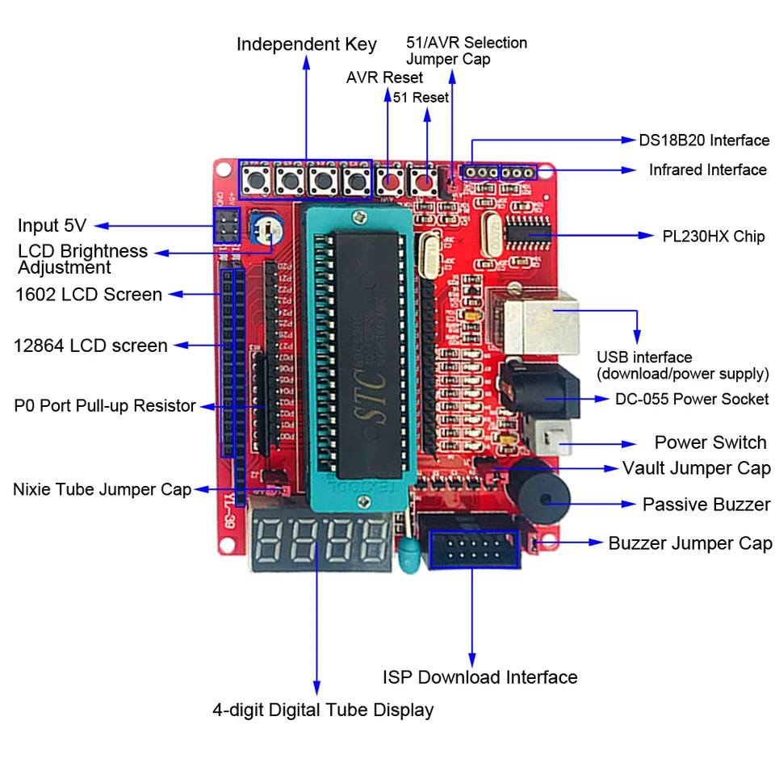

# 8051-basic

  

SO BASIC para a placa chinesa YL-39 equipada com o microcontrolador STC89C52RC.
Para mais informações [veja uma rápida demonstração clicando aqui...](./yl39-8051.mp4)

## Comandos suportados: 

| Grupo | Comando | Exemplo |
|---|---|---|
| * | `HELP` | Lista todos os comandos...|
| Edição | `RUN`, `LIST [n]`, `NEW` | `LIST 100` lista a partir da linha 100|
| Edição | Linha com número guarda; só o número apaga | `20` apaga a linha 20 |
| EEPROM | `SAVE`, `LOAD` | Salva/Carrega o programa|
| Saída | `PRINT` ou `?`; `;` junta, `,` tabula | `? "A="; A, B` |
| Entrada | `INPUT ["texto",] var` | `INPUT "IDADE", A` |
| Variáveis | `LET` (opcional), A a Z | `A=5: B=A*2` |
| Desvio | `IF expr [THEN] ...`, `GOTO`, `GOSUB`, `RETURN`, `END` | `IF A>3 GOTO 100` |
| Laço | `FOR v=a TO b [STEP s]`, `NEXT [v]` | `FOR I=10 TO 0 STEP -2` |
| Comentário | `REM` | `REM INICIO` |
| Placa | `LED n` (bits de n; 1 = D1, 255 = todos) | `LED 85` |
| Placa | `DISP n` (display de 4 segmentos) | `DISP 5*5` |
| Placa | `BEEP [ms[,hz]]` (padrão 100 ms, 2000 Hz; volume = `V` do `PLAY`) | `BEEP 300, 440` |
| Placa | `PAUSE ms` | `PAUSE 500` |
| Placa | `PLAY` | `PLAY "CDEFRFFRCDCDRDDRCGFEREERCDEF"` |
| Placa | `MORSE` | `MORSE "SOS"` |
| Placa | `POKE end, valor` e `PEEK(end)` | `POKE 144, 0` acende os LEDs |
| Funções | `RND(n)` = 1..n, `ABS(n)`, `KEY(n)` = 1 se Kn (3–6) apertado | `10 BEEP KEY(4)*100: GOTO 10` |
| Operadores | `+ - * /`, `MOD` (ou `%`), `AND OR XOR NOT`, `= <> < <= >=`, parênteses | `? 14 MOD 5, 3 AND 6` |

### Notas gerais

- **Números:** inteiros de 16 bits (−32768 a 32767); comparações valem 1 ou 0.
- **Vários comandos por linha:** separados por `:`; linha digitada de até 59 caracteres (o terminal apita ao passar).
- **Limites:** 4 níveis de `GOSUB`, 4 de `FOR` e 3 de parênteses; `Ctrl-C` interrompe `RUN`, `LIST`, `PLAY` e `PAUSE`.
- **Erros:** `?SINTAXE`, `?LINHA NAO EXISTE`, `?MEMORIA CHEIA`, `?DIV POR ZERO`, `?PILHA`, `?PARADO`, `?EEPROM VAZIA`, `?ENDERECO`, seguidos de `NA LINHA n` quando o erro ocorre num programa.

## PLAY (estilo MSX mas com apenas 1 canal)

| Comando | Significado | Padrão |
|---|---|---|
| `C D E F G A B` | Notas; `#` ou `+` sustenido, `-` bemol | — |
| Número após a nota | Duração 1–64 (4 = semínima, 8 = colcheia); `.` aumenta metade | `L` |
| `R` | Pausa | — |
| `O n`, `>`, `<` | Oitava 1–8; sobe ou desce uma | 4 |
| `L n` | Duração padrão | 4 |
| `T n` | Andamento, 32–255 semínimas por minuto | 120 |
| `V n` | Volume 0–15 (duty cycle; 15 = 50%) | 8 |

- **Estado:** oitava, duração, andamento e volume continuam valendo entre `PLAY`s; `RUN` volta ao padrão.
- **Canais 2 e 3:** `PLAY "A","B","C"` é aceito, mas só o primeiro toca.
- **Exemplo:** `PLAY "CDEFRFFRCDCDRDDRCGFEREERCDEF"`

## PEEK e POKE

Endereços 0–127 são a RAM interna (onde o próprio BASIC guarda dados: escrever sem cuidado pode travar, e um reset resolve). De 128 em diante são os SFRs da tabela abaixo; os demais respondem `?ENDERECO`.

| SFR | Endereço | SFR | Endereço |
|---|---|---|---|
| P0 (segmentos) | 128 | SCON | 152 |
| P1 (LEDs, 0 acende) | 144 | IE | 168 |
| P2 (dígitos) | 160 | IP | 184 |
| P3 (botões, buzzer) | 176 | T2CON | 200 |
| TCON / TMOD | 136 / 137 | PSW | 208 |
| TL0 / TL1 / TH0 / TH1 | 138 / 139 / 140 / 141 | | |

> No 8051, um SFR só é acessível por instrução com o endereço fixo no código; por isso cada SFR da lista tem o seu trecho de código próprio e não há acesso a um SFR qualquer.

<!-- . -->
